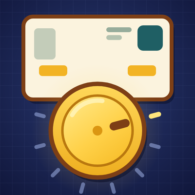

<p align="center"></p>

# DialedInUI

One-click layouts for World of Warcraft: Forever, built entirely on Blizzard's
own UI.

Pick a setup from the list, look at a sketch of it, click Apply. DialedInUI moves
your frames with Edit Mode, adjusts a few common game options, and reloads the
UI. If you don't like it, Undo puts everything back the way it was.

No frames are replaced and nothing is reskinned. Every layout is a normal Edit
Mode layout called **DialedInUI**, so once it's applied you can open Edit Mode
and keep adjusting it like any layout you made yourself.

## Layouts

| Layout | Best for |
|---|---|
| **Center Stage** | Dungeons and raids, DPS and tanks. Player, target, cooldowns and cast bar in one column under your character. |
| **Classic 2004** | Classic veterans. Blizzard's Classic layout with the overlaps fixed and modern extras hidden. |
| **Clean Slate** | Exploring, leveling, screenshots. Bars and cooldowns only show when you need them. |
| **Healer Focus** | Healers. Party and raid frames in the lower middle of the screen, mouseover casting on. |
| **Mirror Panels** | Former ElvUI users. Chat and damage meter as matching panels in the bottom corners. |
| **Controller** | Gamepad, couch and Steam Deck. Bigger frames and button prompts on Blizzard's gamepad layout. |
| **Ultrawide** | 21:9 and 32:9 monitors. The fight column stays in the middle, side panels pulled in. |
| **Questing** | Your first character. Bigger minimap, quest tracker and chat. |
| **Battleground** | Battlegrounds and world PvP. A tight center cluster and a bigger loss of control alert. |
| **Laptop** | MacBooks and small screens. Everything a little smaller so nothing overlaps. |

Every layout is laid out to fit the default UI scale without frames sitting on
top of each other. The buffs sit beside the minimap and the quest tracker sits
under it, measured from the minimap's real size in Forever, so neither covers
the zone name or the coordinates.

## Install

**CurseForge:** search for DialedInUI in the CurseForge app and install it for
World of Warcraft: Forever.

**Manual:** download the latest release zip and extract it so you end up with
`World of Warcraft/<forever client folder>/Interface/AddOns/DialedInUI/`.
Restart the game and enable DialedInUI on the character select screen.

## Usage

1. Type `/dialed`, or click DialedInUI in the addon list next to the minimap.
2. Click a layout on the left to see a sketch of it and what it changes.
3. Click **Apply**, then click again to confirm. Your UI reloads with the new
   layout.
4. To go back, open the window and click **Undo**, or type `/dialed undo`.

Untick **Also change game settings** to apply only the frame positions and
leave your options alone.

## What it changes

- **Frame positions and sizes**, saved as an Edit Mode account layout named
  DialedInUI. Applying a different layout replaces it.
- **Extra action bars**: a layout that uses Bar 2 or Bar 3 turns them on. Bars
  are never turned off. Bars a layout has no spot for move to rows along the
  top middle if you already have them on, and a few layouts hide them. Undo
  puts them back.
- **Game settings** (optional): things like health and mana numbers, target of
  target, max camera distance, cooldown numbers on buttons, and the Cooldown
  Manager. The picker lists exactly which ones before you apply.

The first time you apply a layout, DialedInUI writes down your active layout and
every setting it is about to change. Undo puts all of it back, even if you
tried several layouts in between.

## Commands

| Command | What it does |
|---|---|
| `/dialed` | Open the layout picker |
| `/dialed list` | List all layouts |
| `/dialed apply <name>` | Apply a layout by name, for example `/dialed apply center` |
| `/dialed apply <name> layoutonly` | Apply only the frame positions |
| `/dialed undo` | Go back to how things were |
| `/dialed status` | Which layout is applied |
| `/dialed check` | Check every layout against your game client |
| `/dialed debug on\|off` | Keep a short diagnostic log in the saved data |

`/dialedinui` works in place of `/dialed`.

## Known limits

- Edit Mode allows 5 account layouts. If you already have 5, delete one in
  Edit Mode before applying.
- Layouts can't be applied in combat or while Edit Mode is open.
- The Controller layout needs the gamepad UI turned on first, and the others
  need it turned off.
- The sketch in the picker is approximate. Frames like buffs and the quest
  tracker change size as you play.
- Layouts are checked at the default UI scale on 16:9, 16:10 and 14 inch
  MacBook screens, with nothing overlapping on any of them. The quest tracker
  grows with the number of quests you track: on a 16:9 screen it stays clear of
  your frames with a normal quest log, but on the narrower two a long list can
  reach down to the target frame. Collapse it, or use the Laptop layout, which
  keeps clear even then.
- Extra action bars are turned on per character. Undo restores them on the
  character that applied the layout.

## Reporting a problem

Open an issue with your game build, the layout you applied, your screen
resolution and UI scale, and a screenshot if you can. Running `/dialed check`
first and including what it prints helps a lot. For deeper problems, run
`/dialed debug on`, reproduce it, type `/reload`, and attach
`WTF/Account/<account>/SavedVariables/DialedInUI.lua`.

## Development

The addon is plain Lua with no libraries.

| File | Purpose |
|---|---|
| `Core.lua` | Apply, undo, slash commands |
| `Layout.lua` | Builds an Edit Mode layout from a preset and saves it |
| `Tweaks.lua` | Game settings and action bar toggles, with undo |
| `Presets.lua` | The ten layouts |
| `Preview.lua` | Works out the sketch shown in the picker |
| `Picker.lua` | The layout picker window |
| `tests/harness.lua` | Runs the addon against a stubbed game API |

The test harness checks every layout against Blizzard's real Edit Mode data,
including that every stored setting decodes back to the intended value, and
that no two frames overlap on 16:9, 16:10 and MacBook screens. GitHub Actions
runs it on every push. Locally it needs a checkout of the `forever` branch of
the WoW UI source mirror:

```
git clone --depth 1 --branch forever https://github.com/Gethe/wow-ui-source
lua5.1 tests/harness.lua . path/to/wow-ui-source
```

## License

MIT. See [LICENSE](LICENSE).
